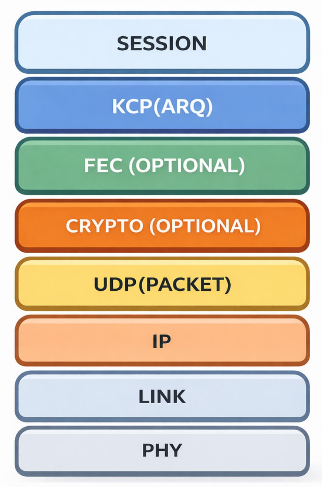
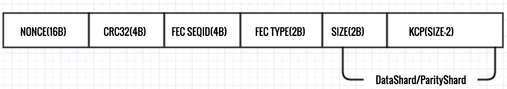
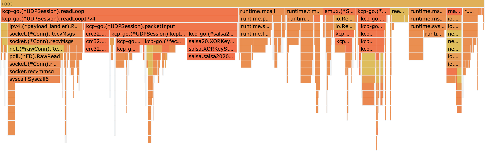

[![GoDoc][1]][2] [![Powered][9]][10] [![MIT licensed][11]][12] [![Build Status][3]][4] [![Coverage Status][7]][8] [![Sourcegraph][13]][14]

[1]: https://godoc.org/github.com/xtaci/kcp-go?status.svg
[2]: https://pkg.go.dev/github.com/xtaci/kcp-go/v5
[3]: https://img.shields.io/github/created-at/xtaci/kcp-go
[4]: https://img.shields.io/github/created-at/xtaci/kcp-go
[7]: https://codecov.io/gh/xtaci/kcp-go/branch/master/graph/badge.svg
[8]: https://codecov.io/gh/xtaci/kcp-go
[9]: https://img.shields.io/badge/KCP-Powered-blue.svg
[10]: https://github.com/skywind3000/kcp
[11]: https://img.shields.io/badge/license-MIT-blue.svg
[12]: LICENSE
[13]: https://sourcegraph.com/github.com/xtaci/kcp-go/-/badge.svg
[14]: https://sourcegraph.com/github.com/xtaci/kcp-go?badge


## Table of Contents

- [Introduction](#introduction)
- [Features](#features)
- [Documentation](#documentation)
- [Layer-Model of KCP-GO](#layer-model-of-kcp-go)
- [Key Design Considerations](#key-design-considerations)
  - [1. Slice vs. Container/List](#1-slice-vs-containerlist)
  - [2. Timing Accuracy vs. Syscall clock_gettime](#2-timing-accuracy-vs-syscall-clock_gettime)
  - [3. Memory Management](#3-memory-management)
  - [4. Information Security](#4-information-security)
  - [5. Packet Clocking](#5-packet-clocking)
  - [6. FEC Design Characteristics](#6-fec-design-characteristics)
- [Specification](#specification)
- [Performance](#performance)
- [Typical Flame Graph](#typical-flame-graph)
- [Connection Termination](#connection-termination)
- [FAQ](#faq)
- [Who is using this?](#who-is-using-this)
- [Examples](#examples)
- [Links](#links)

## Introduction

**kcp-go** is a **Reliable-UDP** library for [golang](https://golang.org/).

This library provides a reliable, ordered byte-stream transport over **UDP**. Optional FEC and packet encryption are available. Encryption can hide packet contents, but random per-packet nonces do not make network traffic anonymous: endpoints, packet sizes, timing, and traffic volume may still be observable. It has been deployed across a range of devices and applications, including **online games, live broadcasting, file synchronization, and network acceleration**.

[Latest Release](https://github.com/xtaci/kcp-go/releases)

## Features

1. Designed for **latency-sensitive** scenarios.
2. **Cache-friendly** and **memory-optimized** design, offering an extremely **high-performance** core.
3. Designed to handle thousands of concurrent connections, depending on workload and server resources.
4. Implements [net.Conn](https://golang.org/pkg/net/#Conn) and [net.Listener](https://golang.org/pkg/net/#Listener); its API resembles TCP, but its transport semantics differ.
5. [FEC (Forward Error Correction)](https://en.wikipedia.org/wiki/Forward_error_correction) support using [Reed-Solomon Codes](https://en.wikipedia.org/wiki/Reed%E2%80%93Solomon_error_correction).
6. Packet encryption support for [AES](https://en.wikipedia.org/wiki/Advanced_Encryption_Standard), [TEA](https://en.wikipedia.org/wiki/Tiny_Encryption_Algorithm), [3DES](https://en.wikipedia.org/wiki/Triple_DES), [Blowfish](https://en.wikipedia.org/wiki/Blowfish_(cipher)), [Cast5](https://en.wikipedia.org/wiki/CAST-128), [Salsa20](https://en.wikipedia.org/wiki/Salsa20), and other algorithms. The legacy block-cipher mode uses [CFB](https://en.wikipedia.org/wiki/Block_cipher_mode_of_operation#Cipher_Feedback_(CFB)); not all supported algorithms use CFB.
7. Supports packet encryption with [AEAD](https://en.wikipedia.org/wiki/Authenticated_encryption).
8. A shared timer scheduler drives KCP updates; goroutines for socket reading and packet processing depend on the connection and transport setup.
9. Compatible with [skywind3000's](https://github.com/skywind3000) C version, with various improvements.
10. Platform-specific optimizations: [sendmmsg](http://man7.org/linux/man-pages/man2/sendmmsg.2.html) and [recvmmsg](http://man7.org/linux/man-pages/man2/recvmmsg.2.html) for Linux.

## Documentation

For complete documentation, see the associated [Godoc](https://pkg.go.dev/github.com/xtaci/kcp-go/v5).


### Layer-Model of KCP-GO



## Key Design Considerations

### 1. Slice vs. Container/List

The KCP flush path scans the in-flight send buffer to find segments that need transmission or retransmission. The ring-buffer representation supports sequential traversal with good locality; the scan cost depends on the number of in-flight segments and how often the session is updated.

I wrote a benchmark comparing sequential loops through a *slice* and a *container/list* [here](https://gist.github.com/xtaci/ac2f13f0108494d874b25551134e4c9c):

```
BenchmarkLoopSlice-4   	2000000000	         0.39 ns/op
BenchmarkLoopList-4    	100000000	        54.6 ns/op
```

The list structure introduces **heavy cache misses** compared to the slice, which offers better **locality**. In the linked benchmark, for 5,000 connections with a 32-window size and a 20 ms update interval, using a slice costs 6 μs (0.03% CPU) per `kcp.flush()`, whereas using a list costs 8.7 ms (43.5% CPU). These figures are benchmark-specific; actual cost depends on workload and hardware.

### 2. Timing Accuracy and RTT Estimation

Timing is **critical** for the **RTT estimator**. Inaccurate timing can cause premature or delayed retransmissions. KCP uses `currentMs()`, which derives elapsed monotonic time from a package reference point. The `time.Now()` numbers below are measurements from a historical benchmark on the listed hardware, not portable performance guarantees.

The benchmark for `time.Now()` is [here](https://gist.github.com/xtaci/f01503b9167f9b520b8896682b67e14d):

```
BenchmarkNow-4         	100000000	        15.6 ns/op
```

The number of clock reads varies with the flush path: KCP samples time while checking retransmission deadlines and when preparing transmissions. The `time.Now()` benchmark above is historical and should not be treated as a measurement of current `currentMs()` cost or as a per-flush cost estimate.

### 3. Memory Management

Many packet buffers are obtained from the package-wide `defaultBufferPool`, which provides buffers with a fixed capacity of 1500 bytes (`mtuLimit`). Buffers are returned to the pool when they are no longer needed, reducing repeated allocations. The pool uses `sync.Pool`, so the Go runtime may discard pooled buffers during garbage collection; reuse and retention are not guaranteed.

### 4. Information Security

Applications commonly use TLS or a similar protocol to protect application data. That protection does not extend to the KCP and FEC headers added below the application layer. kcp-go's packet protection is a separate layer: it can encrypt and, when using AEAD, authenticate each UDP payload, including those transport headers.

Packet integrity depends on the selected mode. When a non-AEAD `BlockCrypt` is configured, kcp-go adds a CRC-32 checksum; if an encryption cipher is enabled, the checksum is carried within the encrypted packet. CRC-32 can detect many accidental transmission errors, but it is not a message authentication code: it is unkeyed, and CRC-32's linearity combined with the malleability of modes such as CFB means an active attacker may be able to modify packets without detection. Do not rely on non-AEAD modes for cryptographic integrity or authentication. AEAD modes authenticate each packet's encrypted contents and are recommended when protection against deliberate packet modification is required. AEAD packet authentication proves possession of the configured key; it does not by itself establish a peer's identity, replace secure key management, or guarantee application-level replay protection.

Packet encryption protects packet contents, including FEC and KCP headers, but does not hide traffic metadata such as endpoints, packet sizes, timing, or traffic volume. A random nonce for each packet helps prevent repeated encryption inputs from producing repeated ciphertext, but it does not conceal this metadata or provide anonymity. Without packet encryption, packet contents are transmitted in plaintext. Algorithm performance varies by hardware and workload, so benchmark the available options in your deployment rather than assuming one cipher is always faster.

Other possible attacks on kcp-go include:

- **[Traffic analysis](https://en.wikipedia.org/wiki/Traffic_analysis):** Packet sizes, timing, and endpoints can reveal communication patterns even when packet contents are encrypted. Multiplexing streams with [smux](https://github.com/xtaci/smux) does not eliminate traffic analysis.
- **[Replay attack](https://en.wikipedia.org/wiki/Replay_attack):** Packet encryption does not by itself establish peer identity or guarantee application messages are processed only once. Applications that need these properties should use an authenticated protocol and implement appropriate replay protection.

### 5. Packet Clocking

1. **Immediate flush on window progress or fast retransmit**: Flush pending data when acknowledgments advance the send window or trigger fast retransmission, without waiting for the next periodic update.
2. **ACK clocking**: Flush ACKs when the pending ACK list reaches approximately one MTU's worth of ACK segments, rather than waiting for the periodic update.
   In high-speed networks, this acts as a higher-frequency "clock signal," potentially boosting unidirectional transmission speed by approximately 6x. For instance, if a batch takes only 1.5ms to process on a high-speed link but still adheres to a fixed 10ms transmission cycle, the actual throughput would be limited to 1/6 of the potential.
3. **Packet batching**: The session packet-processing path batches outgoing packets and uses platform-specific batched I/O where available. This can reduce syscall overhead; it is not a packet pacing mechanism.
4. **Data structures**: The `snd_buf` ring buffer supports cache-friendly sequential traversal. Retransmission checks are O(n) in the number of in-flight segments, so very large windows can increase per-update work.

Ultimately, nothing is more critical in a transmission system than the clock (real-time performance).

### 6. FEC Design Characteristics

- Reed-Solomon encoding and decoding are performed in the outgoing and incoming packet-processing paths.
- Data/parity ratios are configurable per session. More parity can recover more packet loss, at the cost of additional bandwidth; the overhead depends on the configured ratio.
- Encoder and decoder buffers are reused where possible to reduce allocations; actual memory use depends on traffic and configuration.
- When enough shards arrive, the decoder attempts to reconstruct missing data packets and passes recovered packets to KCP for normal processing.
- When packet encryption is enabled, FEC headers are included in the encrypted packet. AEAD authenticates packet contents; non-AEAD modes with CRC-32 do not provide cryptographic authentication.

## Specification



```
NONCE:
  Per-packet nonce; its size depends on the encryption mode (16 bytes for
  the legacy mode, or the configured AEAD nonce size).
  
CRC32:
  IEEE CRC-32 checksum used by non-AEAD modes; AEAD uses an authentication tag.
 
FEC TYPE:
  typeData = 0xF1
  typeParity = 0xF2
  
FEC SEQID:
  Increments modulo (0xffffffff/shardSize) * shardSize; valid IDs are in
  [0, (0xffffffff/shardSize) * shardSize - 1].
  
SIZE:
  Number of bytes from the 2-byte SIZE field through the end of the packet:
  the KCP frame plus 2 bytes. The payload after the SIZE field is SIZE-2 bytes.

KCP Header
+------------------------------+
|           conv (u32)         |
+-------+-------+--------------+
|  cmd  |  frag |     wnd      |
|  u8   |  u8   |     u16      |
+------------------------------+
|           ts   (u32)         |
+------------------------------+
|           sn   (u32)         |
+------------------------------+
|           una  (u32)         |
+------------------------------+
|           data (bytes)       |
+------------------------------+
```

## Performance
```
2025/11/26 11:12:51 beginning tests, encryption:salsa20, fec:10/3
goos: linux
goarch: amd64
pkg: github.com/xtaci/kcp-go/v5
cpu: AMD Ryzen 9 5950X 16-Core Processor
BenchmarkSM4
BenchmarkSM4-32                            56077             21672 ns/op         138.43 MB/s           0 B/op          0 allocs/op
BenchmarkAES128
BenchmarkAES128-32                        525854              2228 ns/op        1346.69 MB/s           0 B/op          0 allocs/op
BenchmarkAES192
BenchmarkAES192-32                        473692              2429 ns/op        1234.95 MB/s           0 B/op          0 allocs/op
BenchmarkAES256
BenchmarkAES256-32                        427497              2725 ns/op        1101.06 MB/s           0 B/op          0 allocs/op
BenchmarkTEA
BenchmarkTEA-32                           149976              8085 ns/op         371.06 MB/s           0 B/op          0 allocs/op
BenchmarkXOR
BenchmarkXOR-32                         12333190                92.35 ns/op     32485.16 MB/s          0 B/op          0 allocs/op
BenchmarkBlowfish
BenchmarkBlowfish-32                       70762             16983 ns/op         176.65 MB/s           0 B/op          0 allocs/op
BenchmarkNone
BenchmarkNone-32                        47325206                24.49 ns/op     122482.39 MB/s         0 B/op          0 allocs/op
BenchmarkCast5
BenchmarkCast5-32                          66837             18035 ns/op         166.35 MB/s           0 B/op          0 allocs/op
Benchmark3DES
Benchmark3DES-32                           18402             64349 ns/op          46.62 MB/s           0 B/op          0 allocs/op
BenchmarkTwofish
BenchmarkTwofish-32                        56440             21380 ns/op         140.32 MB/s           0 B/op          0 allocs/op
BenchmarkXTEA
BenchmarkXTEA-32                           45616             26124 ns/op         114.84 MB/s           0 B/op          0 allocs/op
BenchmarkSalsa20
BenchmarkSalsa20-32                       525685              2199 ns/op        1363.97 MB/s           0 B/op          0 allocs/op
BenchmarkCRC32
BenchmarkCRC32-32                       19418395                59.05 ns/op     17341.83 MB/s
BenchmarkCsprngSystem
BenchmarkCsprngSystem-32                 2912889               404.3 ns/op        39.58 MB/s
BenchmarkCsprngMD5
BenchmarkCsprngMD5-32                   15063580                79.23 ns/op      201.95 MB/s
BenchmarkCsprngSHA1
BenchmarkCsprngSHA1-32                  20186407                60.04 ns/op      333.08 MB/s
BenchmarkCsprngNonceMD5
BenchmarkCsprngNonceMD5-32              13863704                85.11 ns/op      187.98 MB/s
BenchmarkCsprngNonceAES128
BenchmarkCsprngNonceAES128-32           97239751                12.56 ns/op     1274.09 MB/s
BenchmarkFECDecode
BenchmarkFECDecode-32                    1808791               679.1 ns/op      2208.94 MB/s        1641 B/op          3 allocs/op
BenchmarkFECEncode
BenchmarkFECEncode-32                    6671982               181.4 ns/op      8270.76 MB/s           2 B/op          0 allocs/op
BenchmarkFlush
BenchmarkFlush-32                         322982              3809 ns/op               0 B/op          0 allocs/op
BenchmarkDebugLog
BenchmarkDebugLog-32                    1000000000               0.2146 ns/op
BenchmarkEchoSpeed4K
BenchmarkEchoSpeed4K-32                    35583             32875 ns/op         124.59 MB/s       18223 B/op        148 allocs/op
BenchmarkEchoSpeed64K
BenchmarkEchoSpeed64K-32                    1995            510301 ns/op         128.43 MB/s      284233 B/op       2297 allocs/op
BenchmarkEchoSpeed512K
BenchmarkEchoSpeed512K-32                    259           4058131 ns/op         129.19 MB/s     2243058 B/op      18148 allocs/op
BenchmarkEchoSpeed1M
BenchmarkEchoSpeed1M-32                      145           8561996 ns/op         122.47 MB/s     4464227 B/op      36009 allocs/op
BenchmarkSinkSpeed4K
BenchmarkSinkSpeed4K-32                   194648             42136 ns/op          97.21 MB/s        2073 B/op         50 allocs/op
BenchmarkSinkSpeed64K
BenchmarkSinkSpeed64K-32                   10000            113038 ns/op         579.77 MB/s       29242 B/op        741 allocs/op
BenchmarkSinkSpeed256K
BenchmarkSinkSpeed256K-32                   1555            843724 ns/op         621.40 MB/s      229558 B/op       5850 allocs/op
BenchmarkSinkSpeed1M
BenchmarkSinkSpeed1M-32                      667           1783214 ns/op         588.03 MB/s      462691 B/op      11694 allocs/op
PASS
ok      github.com/xtaci/kcp-go/v5      49.978s
```

```
===
Model Name:	MacBook Pro
Model Identifier:	MacBookPro14,1
Processor Name:	Intel Core i5
Processor Speed:	3.1 GHz
Number of Processors:	1
Total Number of Cores:	2
L2 Cache (per Core):	256 KB
L3 Cache:	4 MB
Memory:	8 GB
===

$ go test -v -run=^$ -bench .
beginning tests, encryption:salsa20, fec:10/3
goos: darwin
goarch: amd64
pkg: github.com/xtaci/kcp-go
BenchmarkSM4-4                 	   50000	     32180 ns/op	  93.23 MB/s	       0 B/op	       0 allocs/op
BenchmarkAES128-4              	  500000	      3285 ns/op	 913.21 MB/s	       0 B/op	       0 allocs/op
BenchmarkAES192-4              	  300000	      3623 ns/op	 827.85 MB/s	       0 B/op	       0 allocs/op
BenchmarkAES256-4              	  300000	      3874 ns/op	 774.20 MB/s	       0 B/op	       0 allocs/op
BenchmarkTEA-4                 	  100000	     15384 ns/op	 195.00 MB/s	       0 B/op	       0 allocs/op
BenchmarkXOR-4                 	20000000	        89.9 ns/op	33372.00 MB/s	       0 B/op	       0 allocs/op
BenchmarkBlowfish-4            	   50000	     26927 ns/op	 111.41 MB/s	       0 B/op	       0 allocs/op
BenchmarkNone-4                	30000000	        45.7 ns/op	65597.94 MB/s	       0 B/op	       0 allocs/op
BenchmarkCast5-4               	   50000	     34258 ns/op	  87.57 MB/s	       0 B/op	       0 allocs/op
Benchmark3DES-4                	   10000	    117149 ns/op	  25.61 MB/s	       0 B/op	       0 allocs/op
BenchmarkTwofish-4             	   50000	     33538 ns/op	  89.45 MB/s	       0 B/op	       0 allocs/op
BenchmarkXTEA-4                	   30000	     45666 ns/op	  65.69 MB/s	       0 B/op	       0 allocs/op
BenchmarkSalsa20-4             	  500000	      3308 ns/op	 906.76 MB/s	       0 B/op	       0 allocs/op
BenchmarkCRC32-4               	20000000	        65.2 ns/op	15712.43 MB/s
BenchmarkCsprngSystem-4        	 1000000	      1150 ns/op	  13.91 MB/s
BenchmarkCsprngMD5-4           	10000000	       145 ns/op	 110.26 MB/s
BenchmarkCsprngSHA1-4          	10000000	       158 ns/op	 126.54 MB/s
BenchmarkCsprngNonceMD5-4      	10000000	       153 ns/op	 104.22 MB/s
BenchmarkCsprngNonceAES128-4   	100000000	        19.1 ns/op	 837.81 MB/s
BenchmarkFECDecode-4           	 1000000	      1119 ns/op	1339.61 MB/s	    1606 B/op	       2 allocs/op
BenchmarkFECEncode-4           	 2000000	       832 ns/op	1801.83 MB/s	      17 B/op	       0 allocs/op
BenchmarkFlush-4               	 5000000	       272 ns/op	       0 B/op	       0 allocs/op
BenchmarkEchoSpeed4K-4         	    5000	    259617 ns/op	  15.78 MB/s	    5451 B/op	     149 allocs/op
BenchmarkEchoSpeed64K-4        	    1000	   1706084 ns/op	  38.41 MB/s	   56002 B/op	    1604 allocs/op
BenchmarkEchoSpeed512K-4       	     100	  14345505 ns/op	  36.55 MB/s	  482597 B/op	   13045 allocs/op
BenchmarkEchoSpeed1M-4         	      30	  34859104 ns/op	  30.08 MB/s	 1143773 B/op	   27186 allocs/op
BenchmarkSinkSpeed4K-4         	   50000	     31369 ns/op	 130.57 MB/s	    1566 B/op	      30 allocs/op
BenchmarkSinkSpeed64K-4        	    5000	    329065 ns/op	 199.16 MB/s	   21529 B/op	     453 allocs/op
BenchmarkSinkSpeed256K-4       	     500	   2373354 ns/op	 220.91 MB/s	  166332 B/op	    3554 allocs/op
BenchmarkSinkSpeed1M-4         	     300	   5117927 ns/op	 204.88 MB/s	  310378 B/op	    6988 allocs/op
PASS
ok  	github.com/xtaci/kcp-go	50.349s
```

```
=== Raspberry Pi 4 ===

➜  kcp-go git:(master) cat /proc/cpuinfo
processor	: 0
model name	: ARMv7 Processor rev 3 (v7l)
BogoMIPS	: 108.00
Features	: half thumb fastmult vfp edsp neon vfpv3 tls vfpv4 idiva idivt vfpd32 lpae evtstrm crc32
CPU implementer	: 0x41
CPU architecture: 7
CPU variant	: 0x0
CPU part	: 0xd08
CPU revision	: 3

➜  kcp-go git:(master)  go test -run=^$ -bench .
2020/01/05 19:25:13 beginning tests, encryption:salsa20, fec:10/3
goos: linux
goarch: arm
pkg: github.com/xtaci/kcp-go/v5
BenchmarkSM4-4                     20000             86475 ns/op          34.69 MB/s           0 B/op          0 allocs/op
BenchmarkAES128-4                  20000             62254 ns/op          48.19 MB/s           0 B/op          0 allocs/op
BenchmarkAES192-4                  20000             71802 ns/op          41.78 MB/s           0 B/op          0 allocs/op
BenchmarkAES256-4                  20000             80570 ns/op          37.23 MB/s           0 B/op          0 allocs/op
BenchmarkTEA-4                     50000             37343 ns/op          80.34 MB/s           0 B/op          0 allocs/op
BenchmarkXOR-4                    100000             22266 ns/op         134.73 MB/s           0 B/op          0 allocs/op
BenchmarkBlowfish-4                20000             66123 ns/op          45.37 MB/s           0 B/op          0 allocs/op
BenchmarkNone-4                  3000000               518 ns/op        5786.77 MB/s           0 B/op          0 allocs/op
BenchmarkCast5-4                   20000             76705 ns/op          39.11 MB/s           0 B/op          0 allocs/op
Benchmark3DES-4                     5000            418868 ns/op           7.16 MB/s           0 B/op          0 allocs/op
BenchmarkTwofish-4                  5000            326896 ns/op           9.18 MB/s           0 B/op          0 allocs/op
BenchmarkXTEA-4                    10000            114418 ns/op          26.22 MB/s           0 B/op          0 allocs/op
BenchmarkSalsa20-4                 50000             36736 ns/op          81.66 MB/s           0 B/op          0 allocs/op
BenchmarkCRC32-4                 1000000              1735 ns/op         589.98 MB/s
BenchmarkCsprngSystem-4          1000000              2179 ns/op           7.34 MB/s
BenchmarkCsprngMD5-4             2000000               811 ns/op          19.71 MB/s
BenchmarkCsprngSHA1-4            2000000               862 ns/op          23.19 MB/s
BenchmarkCsprngNonceMD5-4        2000000               878 ns/op          18.22 MB/s
BenchmarkCsprngNonceAES128-4     5000000               326 ns/op          48.97 MB/s
BenchmarkFECDecode-4              200000              9081 ns/op         165.16 MB/s         140 B/op          1 allocs/op
BenchmarkFECEncode-4              100000             12039 ns/op         124.59 MB/s          11 B/op          0 allocs/op
BenchmarkFlush-4                  100000             21704 ns/op               0 B/op          0 allocs/op
BenchmarkEchoSpeed4K-4              2000            981182 ns/op           4.17 MB/s       12384 B/op        424 allocs/op
BenchmarkEchoSpeed64K-4              100          10503324 ns/op           6.24 MB/s      123616 B/op       3779 allocs/op
BenchmarkEchoSpeed512K-4              20         138633802 ns/op           3.78 MB/s     1606584 B/op      29233 allocs/op
BenchmarkEchoSpeed1M-4                 5         372903568 ns/op           2.81 MB/s     4080504 B/op      63600 allocs/op
BenchmarkSinkSpeed4K-4             10000            121239 ns/op          33.78 MB/s        4647 B/op        104 allocs/op
BenchmarkSinkSpeed64K-4             1000           1587906 ns/op          41.27 MB/s       50914 B/op       1115 allocs/op
BenchmarkSinkSpeed256K-4             100          16277830 ns/op          32.21 MB/s      453027 B/op       9296 allocs/op
BenchmarkSinkSpeed1M-4               100          31040703 ns/op          33.78 MB/s      898097 B/op      18932 allocs/op
PASS
ok      github.com/xtaci/kcp-go/v5      64.151s
```


## Typical Flame Graph



## Connection Termination

Control messages like **SYN/FIN/RST** in TCP **are not defined** in KCP. You need a **keepalive/heartbeat mechanism** at the application level. A practical example is to use a **multiplexing** protocol over the session, such as [smux](https://github.com/xtaci/smux) (which has an embedded keepalive mechanism).

## FAQ

**Q: I'm handling thousands of connections on my server, and CPU utilization is high.**

**A:** Profile the workload and consider separating KCP traffic into a dedicated service. If the session is currently using a short update interval (for example, 10 ms), increasing it (for example, to 40 ms with `conn.SetNoDelay(1, 40, 1, 1)`) may reduce scheduling and update overhead, at the cost of response latency. The default KCP interval is 100 ms, so 40 ms is not an increase over the default.

**Q: When should I enable FEC?**

**A:** FEC can recover some packet losses without waiting for retransmission, which may reduce latency on lossy links. It adds bandwidth and processing overhead and cannot recover losses beyond the configured parity capacity. Benchmark with representative loss patterns and tune the data/parity ratio for your workload.

**Q: Should I enable encryption?**

**A:** If you need protection for KCP/FEC headers in addition to application data, configure packet encryption. Prefer AEAD when UDP-packet integrity and authentication are required. If the application already uses TLS, packet encryption is not a substitute for TLS; whether to enable the additional layer depends on your threat model and overhead requirements.

## Who is using this?

1. https://github.com/getlantern/lantern -- Lantern delivers fast access to the open Internet.
2. https://github.com/smallnest/rpcx -- An RPC service framework based on net/rpc, similar to Alibaba Dubbo and Weibo Motan.
3. https://github.com/gonet2/agent -- A gateway for games with stream multiplexing.
4. https://github.com/syncthing/syncthing -- Open Source Continuous File Synchronization.
5. https://github.com/hanselime/paqet -- A bidirectional packet-level proxy built using raw sockets and KCP.

### Looking for a C++ client?
1. https://github.com/xtaci/libkcp -- FEC enhanced KCP session library for iOS/Android in C++

## Examples

1. [simple examples](https://github.com/xtaci/kcp-go/tree/master/examples)

## Links

1. https://github.com/xtaci/smux/ -- A Stream Multiplexing Library for golang with least memory
1. **https://github.com/xtaci/libkcp -- FEC enhanced KCP session library for iOS/Android in C++**
1. https://github.com/skywind3000/kcp -- A Fast and Reliable ARQ Protocol
1. https://github.com/klauspost/reedsolomon -- Reed-Solomon Erasure Coding in Go
