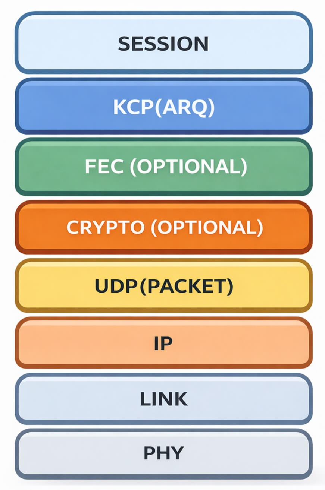
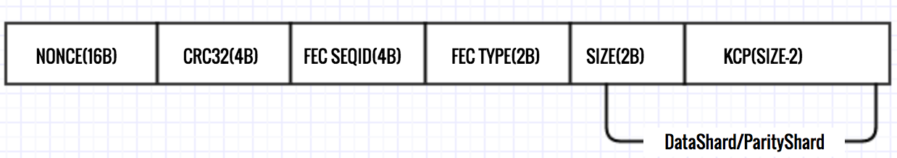
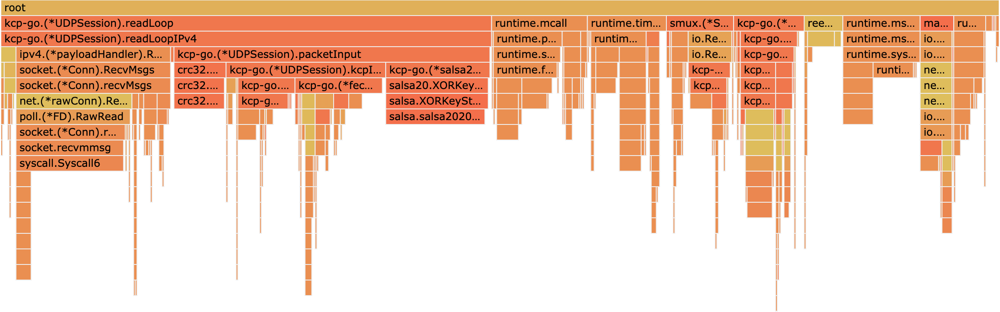

[![GoDoc][1]][2] [![Created At][3]][4] [![MIT licensed][11]][12] [![Coverage Status][7]][8]

[1]: https://godoc.org/github.com/xtaci/kcp-go?status.svg
[2]: https://pkg.go.dev/github.com/xtaci/kcp-go/v5
[3]: https://img.shields.io/github/created-at/xtaci/kcp-go
[4]: https://github.com/xtaci/kcp-go
[7]: https://codecov.io/gh/xtaci/kcp-go/branch/master/graph/badge.svg
[8]: https://codecov.io/gh/xtaci/kcp-go
[11]: https://img.shields.io/badge/license-MIT-blue.svg
[12]: LICENSE


## Table of Contents

- [Introduction](#introduction)
- [Quick Start](#quick-start)
- [Features](#features)
- [Documentation](#documentation)
- [Layer-Model of KCP-GO](#layer-model-of-kcp-go)
- [Design and Tuning Notes](#design-and-tuning-notes)
  - [1. Slice vs. Container/List](#1-slice-vs-containerlist)
  - [2. Timing Accuracy and RTT Estimation](#2-timing-accuracy-and-rtt-estimation)
  - [3. Memory Management](#3-memory-management)
  - [4. Per-session Outbound Rate Limiting](#4-per-session-outbound-rate-limiting)
  - [5. Information Security](#5-information-security)
  - [6. Packet Clocking](#6-packet-clocking)
  - [7. FEC Design Characteristics](#7-fec-design-characteristics)
- [Specification](#specification)
- [Performance](#performance)
- [Typical Flame Graph](#typical-flame-graph)
- [Connection Termination and Multiplexing](#connection-termination-and-multiplexing)
- [FAQ](#faq)
- [Who is using this?](#who-is-using-this)
- [Examples](#examples)
- [Links](#links)

## Introduction

**kcp-go** is a **Reliable-UDP** library for [golang](https://golang.org/).

This library provides a reliable, ordered byte-stream transport over **UDP**. Optional FEC and packet encryption are available. Encryption can hide packet contents, but random per-packet nonces do not make network traffic anonymous: endpoints, packet sizes, timing, and traffic volume may still be observable. It has been deployed across a range of devices and applications, including **online games, live broadcasting, file synchronization, and network acceleration**.

[Latest Release](https://github.com/xtaci/kcp-go/releases)

## Quick Start

`kcp-go` implements `net.Conn` and `net.Listener`, so applications can use familiar stream I/O. These standalone examples show a basic echo server and client; they use no packet encryption or FEC.

Echo server:

```go
package main

import (
	"io"
	"log"
	"net"

	"github.com/xtaci/kcp-go/v5"
)

func main() {
	ln, err := kcp.Listen("127.0.0.1:12345")
	if err != nil {
		log.Fatal(err)
	}
	defer ln.Close()

	for {
		conn, err := ln.Accept()
		if err != nil {
			log.Fatal(err)
		}
		go func(conn net.Conn) {
			defer conn.Close()
			if _, err := io.Copy(conn, conn); err != nil {
				log.Println(err)
			}
		}(conn)
	}
}
```

Echo client:

```go
package main

import (
	"fmt"
	"io"
	"log"

	"github.com/xtaci/kcp-go/v5"
)

func main() {
	conn, err := kcp.Dial("127.0.0.1:12345")
	if err != nil {
		log.Fatal(err)
	}
	defer conn.Close()

	payload := []byte("hello over KCP")
	if _, err := conn.Write(payload); err != nil {
		log.Fatal(err)
	}
	reply := make([]byte, len(payload))
	if _, err := io.ReadFull(conn, reply); err != nil {
		log.Fatal(err)
	}
	fmt.Println(string(reply))
}
```

For optional packet encryption or FEC, use `ListenWithOptions` and `DialWithOptions`. Both peers must use matching encryption keys. The sender's FEC shard settings configure its encoder; the receiver can automatically detect and adapt to the sender's data/parity shard counts. See [Godoc](https://pkg.go.dev/github.com/xtaci/kcp-go/v5) for configuration details.

## Features

- Reliable, ordered byte-stream delivery over UDP with configurable latency/throughput trade-offs.
- `net.Conn` and `net.Listener` APIs; the familiar interface does not make the transport TCP.
- Optional Reed-Solomon FEC to recover some packet loss, with configurable data/parity shard counts.
- The FEC receiver can automatically detect and adapt to the sender's shard counts.
- Optional packet encryption, including AEAD for packet-level integrity and authentication.
- SNMP statistics are enabled by default. To disable statistics collection, build with `go build -tags kcp_no_snmp ./...`; in this build, `Snmp` is an empty placeholder and its statistics fields and reporting methods are unavailable.
- A shared timer scheduler and batched, platform-specific UDP I/O to support many sessions efficiently.
- On Linux, macOS, Windows, FreeBSD, OpenBSD, NetBSD, and DragonFly, wildcard UDP listeners use OS control messages to track each packet's local destination and send replies from that address. Other platforms use generic UDP handling without guaranteed source-address preservation.
- Designed for high concurrency; capacity depends on workload, configuration, and hardware.
- Based on [skywind3000's KCP](https://github.com/skywind3000/kcp), with additional features and optimizations.

## Documentation

For complete documentation, see the associated [Godoc](https://pkg.go.dev/github.com/xtaci/kcp-go/v5).


### Layer-Model of KCP-GO



## Design and Tuning Notes

### 1. Slice vs. Container/List

The KCP flush path scans the in-flight send buffer to find segments that need transmission or retransmission. The ring-buffer representation supports sequential traversal with good locality; the scan cost depends on the number of in-flight segments and how often the session is updated.

I wrote a benchmark comparing sequential loops through a *slice* and a *container/list* [here](https://gist.github.com/xtaci/ac2f13f0108494d874b25551134e4c9c):

```
BenchmarkLoopSlice-4   	2000000000	         0.39 ns/op
BenchmarkLoopList-4    	100000000	        54.6 ns/op
```

The list structure introduces **heavy cache misses** compared to the slice, which offers better **locality**. In the linked benchmark, for 5,000 connections with a 32-window size and a 20 ms update interval, using a slice costs 6 μs (0.03% CPU) per `kcp.flush()`, whereas using a list costs 8.7 ms (43.5% CPU). These figures are benchmark-specific; actual cost depends on workload and hardware.

### 2. Timing Accuracy and RTT Estimation

Timing is **critical** for the **RTT estimator**. Inaccurate timing can cause premature or delayed retransmissions. KCP uses `currentMs()`, which derives elapsed monotonic time from a package reference point. The `time.Now()` numbers below are measurements from a historical benchmark on the listed hardware, not portable performance guarantees.

The benchmark for `time.Now()` is [here](https://gist.github.com/xtaci/f01503b9167f9b520b8896682b67e14d):

```
BenchmarkNow-4         	100000000	        15.6 ns/op
```

The number of clock reads varies with the flush path: KCP samples time while checking retransmission deadlines and when preparing transmissions. The `time.Now()` benchmark above is historical and should not be treated as a measurement of current `currentMs()` cost or as a per-flush cost estimate.

### 3. Memory Management

Many packet buffers are obtained from the package-wide `defaultBufferPool`, which provides buffers with a fixed capacity of 1500 bytes (`mtuLimit`). Buffers are returned to the pool when they are no longer needed, reducing repeated allocations. The pool uses `sync.Pool`, so the Go runtime may discard pooled buffers during garbage collection; reuse and retention are not guaranteed.

### 4. Per-session Application Write Rate Limiting

`UDPSession.SetRateLimit(bytesPerSecond)` configures an independent token-bucket rate limit for application data submitted through `Write` and `WriteBuffers`. The limit is measured in application bytes per second. It does not count KCP/FEC/encryption overhead, FEC parity, retransmissions, `SendOOB` traffic, or UDP/IP headers. Rate limiting is disabled by default, and passing `0` disables it. A throttled write waits for tokens while remaining interruptible by its write deadline, socket write errors, and session closure.

The bucket allows an initial burst of up to `maxBatchSize * maxPacketSize` bytes (currently 64 × 1472 = 94,208 bytes), then limits the average rate at which writes are accepted. Writes larger than the burst capacity are admitted in rate-limited chunks. This controls application write throughput rather than the exact rate of UDP packets on the wire.

```go
sess.SetRateLimit(256 * 1024) // limit this session to 256 KiB/s
sess.SetRateLimit(0)           // disable rate limiting
```

### 5. Information Security

Applications commonly use TLS or a similar protocol to protect application data. That protection does not extend to the KCP and FEC headers added below the application layer. kcp-go's packet protection is a separate layer: it can encrypt and, when using AEAD, authenticate each UDP payload, including those transport headers.

Packet integrity depends on the selected mode. When a non-AEAD `BlockCrypt` is configured, kcp-go adds a CRC-32 checksum; if an encryption cipher is enabled, the checksum is carried within the encrypted packet. After CFB decryption, the receiver verifies this checksum and drops packets corrupted by accidental bit errors. This is only an anti-corruption check, not cryptographic anti-tamper protection: CRC-32 is unkeyed, and its linearity combined with the malleability of modes such as CFB means an active attacker may be able to modify packets without detection. Do not rely on non-AEAD modes for cryptographic integrity or authentication. AEAD modes authenticate each packet's encrypted contents and are recommended when protection against deliberate packet modification is required. AEAD packet authentication proves possession of the configured key; it does not by itself establish a peer's identity, replace secure key management, or guarantee application-level replay protection.

Packet encryption protects packet contents, including FEC and KCP headers, but does not hide traffic metadata such as endpoints, packet sizes, timing, or traffic volume. A random nonce for each packet helps prevent repeated encryption inputs from producing repeated ciphertext, but it does not conceal this metadata or provide anonymity. Without packet encryption, packet contents are transmitted in plaintext. Algorithm performance varies by hardware and workload, so benchmark the available options in your deployment rather than assuming one cipher is always faster.

Other possible attacks on kcp-go include:

- **[Traffic analysis](https://en.wikipedia.org/wiki/Traffic_analysis):** Packet sizes, timing, and endpoints can reveal communication patterns even when packet contents are encrypted. Multiplexing streams with [smux](https://github.com/xtaci/smux) does not eliminate traffic analysis.
- **[Replay attack](https://en.wikipedia.org/wiki/Replay_attack):** Packet encryption does not by itself establish peer identity or guarantee application messages are processed only once. Applications that need these properties should use an authenticated protocol and implement appropriate replay protection.

### 6. Packet Clocking

1. **Immediate flush on window progress or fast retransmit**: Flush pending data when acknowledgments advance the send window or trigger fast retransmission, without waiting for the next periodic update.
2. **ACK clocking**: Flush ACKs when the pending ACK list reaches approximately one MTU's worth of ACK segments, rather than waiting for the periodic update.
   In high-speed networks, this acts as a higher-frequency "clock signal," potentially boosting unidirectional transmission speed by approximately 6x. For instance, if a batch takes only 1.5ms to process on a high-speed link but still adheres to a fixed 10ms transmission cycle, the actual throughput would be limited to 1/6 of the potential.
3. **Packet batching**: The session packet-processing path batches outgoing packets and uses platform-specific batched I/O where available. This can reduce syscall overhead; it is not a packet pacing mechanism.
4. **Data structures**: The `snd_buf` ring buffer supports cache-friendly sequential traversal. Retransmission checks are O(n) in the number of in-flight segments, so very large windows can increase per-update work.

Ultimately, nothing is more critical in a transmission system than the clock (real-time performance).

### 7. FEC Design Characteristics

- Reed-Solomon encoding and decoding are performed in the outgoing and incoming packet-processing paths.
- Data/parity ratios are configurable per session. More parity can recover more packet loss, at the cost of additional bandwidth; the overhead depends on the configured ratio.
- Encoder and decoder buffers are reused where possible to reduce allocations; actual memory use depends on traffic and configuration.
- When enough shards arrive, the decoder attempts to reconstruct missing data packets and passes recovered packets to KCP for normal processing.
- The receiver detects a sender/receiver shard-configuration mismatch from incoming data and parity packet sequence patterns. Once it has enough consecutive samples to identify both shard counts, it rebuilds its decoder and discards shards buffered under the old configuration. Detection tolerates missing or duplicate samples, but may take longer when packets are lost or reordered. The detected configuration is accepted only when the total number of data and parity shards is at most 256.
- When packet encryption is enabled, FEC headers are included in the encrypted packet. AEAD authenticates packet contents; non-AEAD modes with CRC-32 do not provide cryptographic authentication.

## Specification



```
NONCE:
  Per-packet nonce; its size depends on the encryption mode (16 bytes for
  the legacy mode, or the configured AEAD nonce size).
  
CRC32:
  IEEE CRC-32 checksum used by non-AEAD modes; AEAD uses an authentication tag.
 
FEC TYPE:
  typeData = 0xF1
  typeParity = 0xF2
  
FEC SEQID:
  Increments modulo (0xffffffff/shardSize) * shardSize; valid IDs are in
  [0, (0xffffffff/shardSize) * shardSize - 1].
  
SIZE:
  Number of bytes from the 2-byte SIZE field through the end of the packet:
  the KCP frame plus 2 bytes. The payload after the SIZE field is SIZE-2 bytes.

KCP Header
+------------------------------+
|           conv (u32)         |
+-------+-------+--------------+
|  cmd  |  frag |     wnd      |
|  u8   |  u8   |     u16      |
+------------------------------+
|           ts   (u32)         |
+------------------------------+
|           sn   (u32)         |
+------------------------------+
|           una  (u32)         |
+------------------------------+
|           data (bytes)       |
+------------------------------+
```

## Performance

The results below are historical and hardware-specific, not performance guarantees. Run `go test -run='^$' -bench .` on your target system for comparable measurements. Expand a section to see the raw output.

<details>
<summary>Linux amd64 — AMD Ryzen 9 5950X</summary>

```
goos: linux
goarch: amd64
pkg: github.com/xtaci/kcp-go/v5
cpu: AMD Ryzen 9 5950X 16-Core Processor
BenchmarkPacketBufferPoolGetPut
BenchmarkPacketBufferPoolGetPut/ArrayPointer
BenchmarkPacketBufferPoolGetPut/ArrayPointer/Serial
BenchmarkPacketBufferPoolGetPut/ArrayPointer/Serial-32          98010116                12.37 ns/op            0 B/op         0 allocs/op
BenchmarkPacketBufferPoolGetPut/ArrayPointer/Parallel
BenchmarkPacketBufferPoolGetPut/ArrayPointer/Parallel-32                1000000000               0.7148 ns/op          0 B/op          0 allocs/op
BenchmarkPacketBufferPoolGetPut/Slice
BenchmarkPacketBufferPoolGetPut/Slice/Serial
BenchmarkPacketBufferPoolGetPut/Slice/Serial-32                         37707745                27.47 ns/op           24 B/op          1 allocs/op
BenchmarkPacketBufferPoolGetPut/Slice/Parallel
BenchmarkPacketBufferPoolGetPut/Slice/Parallel-32                       81515508                14.07 ns/op           24 B/op          1 allocs/op
BenchmarkConnManagerAllocs
BenchmarkConnManagerAllocs-32                                           28268137                41.17 ns/op           17 B/op          2 allocs/op
BenchmarkConnManagerImplAllocs
BenchmarkConnManagerImplAllocs-32                                       39315105                29.40 ns/op            0 B/op          0 allocs/op
BenchmarkSM4
BenchmarkSM4-32                                                            60841             19203 ns/op         153.31 MB/s           0 B/op          0 allocs/op
BenchmarkAES128
BenchmarkAES128-32                                                        559143              2145 ns/op        1372.49 MB/s           0 B/op          0 allocs/op
BenchmarkAES192
BenchmarkAES192-32                                                        475938              2442 ns/op        1205.33 MB/s           0 B/op          0 allocs/op
BenchmarkAES256
BenchmarkAES256-32                                                        455337              2633 ns/op        1118.05 MB/s           0 B/op          0 allocs/op
BenchmarkTEA
BenchmarkTEA-32                                                           141236              8534 ns/op         344.97 MB/s           0 B/op          0 allocs/op
BenchmarkXOR
BenchmarkXOR-32                                                         24354942                49.34 ns/op     59669.95 MB/s          0 B/op          0 allocs/op
BenchmarkBlowfish
BenchmarkBlowfish-32                                                       71466             16737 ns/op         175.89 MB/s           0 B/op          0 allocs/op
BenchmarkNone
BenchmarkNone-32                                                        52308901                23.10 ns/op     127424.75 MB/s         0 B/op          0 allocs/op
BenchmarkCast5
BenchmarkCast5-32                                                          65563             18238 ns/op         161.42 MB/s           0 B/op          0 allocs/op
Benchmark3DES
Benchmark3DES-32                                                           18531             64510 ns/op          45.64 MB/s           0 B/op          0 allocs/op
BenchmarkTwofish
BenchmarkTwofish-32                                                        55621             21628 ns/op         136.12 MB/s           0 B/op          0 allocs/op
BenchmarkXTEA
BenchmarkXTEA-32                                                           46226             25930 ns/op         113.54 MB/s           0 B/op          0 allocs/op
BenchmarkSalsa20
BenchmarkSalsa20-32                                                       574081              2006 ns/op        1467.64 MB/s           0 B/op          0 allocs/op
BenchmarkCRC32
BenchmarkCRC32-32                                                       20230149                58.73 ns/op     17436.55 MB/s
BenchmarkCFB_AES_128_CRC32
BenchmarkCFB_AES_128_CRC32-32                                             982596              1220 ns/op        1147.27 MB/s
BenchmarkAEAD_AES_128_GCM
BenchmarkAEAD_AES_128_GCM-32                                             4050789               297.7 ns/op      4702.75 MB/s
BenchmarkCFB_Salsa20_CRC32
BenchmarkCFB_Salsa20_CRC32-32                                            1000000              1008 ns/op        1389.40 MB/s
BenchmarkAEAD_Chacha20_Poly1035
BenchmarkAEAD_Chacha20_Poly1035-32                                       2515954               476.0 ns/op      2941.38 MB/s
BenchmarkCsprngSystem
BenchmarkCsprngSystem-32                                                 2676769               448.1 ns/op        35.71 MB/s
BenchmarkCsprngAES128
BenchmarkCsprngAES128-32                                                81380560                14.79 ns/op     1082.14 MB/s
BenchmarkCsprngChacha8
BenchmarkCsprngChacha8-32                                               99872712                12.03 ns/op      664.95 MB/s
BenchmarkFECDecode
BenchmarkFECDecode-32                                                    3835436               315.0 ns/op      4673.44 MB/s         246 B/op          1 allocs/op
BenchmarkFECEncode
BenchmarkFECEncode-32                                                    6003200               200.2 ns/op      7353.66 MB/s           2 B/op          0 allocs/op
BenchmarkFlush
BenchmarkFlush-32                                                         367267              3268 ns/op               0 B/op          0 allocs/op
BenchmarkDebugLog
BenchmarkDebugLog-32                                                    1000000000               1.042 ns/op
BenchmarkEchoSpeed4K
BenchmarkEchoSpeed4K-32                                                    53157             22127 ns/op         185.11 MB/s        1772 B/op         22 allocs/op
BenchmarkEchoSpeed64K
BenchmarkEchoSpeed64K-32                                                    3157            346416 ns/op         189.18 MB/s       27677 B/op        358 allocs/op
BenchmarkEchoSpeed512K
BenchmarkEchoSpeed512K-32                                                    426           2787072 ns/op         188.11 MB/s      222284 B/op       2843 allocs/op
BenchmarkEchoSpeed1M
BenchmarkEchoSpeed1M-32                                                      208           5521962 ns/op         189.89 MB/s      449980 B/op       5684 allocs/op
BenchmarkSinkSpeed4K
BenchmarkSinkSpeed4K-32                                                   126181             10293 ns/op         397.93 MB/s         316 B/op          6 allocs/op
BenchmarkSinkSpeed64K
BenchmarkSinkSpeed64K-32                                                    7675            164723 ns/op         397.86 MB/s        5182 B/op         97 allocs/op
BenchmarkSinkSpeed256K
BenchmarkSinkSpeed256K-32                                                    994           1209617 ns/op         433.43 MB/s       41641 B/op        777 allocs/op
BenchmarkSinkSpeed1M
BenchmarkSinkSpeed1M-32                                                      448           2627570 ns/op         399.07 MB/s       90851 B/op       1551 allocs/op
BenchmarkTimedFuncHeap
BenchmarkTimedFuncHeap-32                                               13520214                88.25 ns/op            0 B/op          0 allocs/op
PASS
ok      github.com/xtaci/kcp-go/v5      51.387s
```
</details>

<details>
<summary>macOS arm64 — Apple M4 Pro</summary>

```
macOS 26.7.3
Apple M4 Pro
12 CPUs, 24 GiB memory
Go 1.27.4

$ go test -run='^$' -bench . -benchmem -count=1
goos: darwin
goarch: arm64
pkg: github.com/xtaci/kcp-go/v5
cpu: Apple M4 Pro
BenchmarkPacketBufferPoolGetPut/ArrayPointer/Serial-12  	183539385	         6.432 ns/op	       0 B/op	       0 allocs/op
BenchmarkPacketBufferPoolGetPut/ArrayPointer/Parallel-12         	1000000000	         0.8019 ns/op	       0 B/op	       0 allocs/op
BenchmarkPacketBufferPoolGetPut/Slice/Serial-12                  	80577022	        13.55 ns/op	      24 B/op	       1 allocs/op
BenchmarkPacketBufferPoolGetPut/Slice/Parallel-12                	143337536	         8.575 ns/op	      24 B/op	       1 allocs/op
BenchmarkConnManagerAllocs-12                                    	53025882	        21.56 ns/op	      17 B/op	       2 allocs/op
BenchmarkConnManagerImplAllocs-12                                	95109146	        12.82 ns/op	       0 B/op	       0 allocs/op
BenchmarkSM4-12                                                  	   66414	     18070 ns/op	 162.93 MB/s	       0 B/op	       0 allocs/op
BenchmarkAES128-12                                               	  794239	      1510 ns/op	1949.97 MB/s	       0 B/op	       0 allocs/op
BenchmarkAES192-12                                               	  743060	      1615 ns/op	1823.37 MB/s	       0 B/op	       0 allocs/op
BenchmarkAES256-12                                               	  681664	      1750 ns/op	1682.12 MB/s	       0 B/op	       0 allocs/op
BenchmarkTEA-12                                                  	  165542	      7192 ns/op	 409.32 MB/s	       0 B/op	       0 allocs/op
BenchmarkXOR-12                                                  	29704960	        40.67 ns/op	72385.73 MB/s	       0 B/op	       0 allocs/op
BenchmarkBlowfish-12                                             	   85344	     14004 ns/op	 210.23 MB/s	       0 B/op	       0 allocs/op
BenchmarkNone-12                                                 	48431604	        24.73 ns/op	119041.32 MB/s	       0 B/op	       0 allocs/op
BenchmarkCast5-12                                                	   83814	     14178 ns/op	 207.64 MB/s	       0 B/op	       0 allocs/op
Benchmark3DES-12                                                 	   21549	     55677 ns/op	  52.88 MB/s	       0 B/op	       0 allocs/op
BenchmarkTwofish-12                                              	   66288	     18091 ns/op	 162.73 MB/s	       0 B/op	       0 allocs/op
BenchmarkXTEA-12                                                 	   48271	     24919 ns/op	 118.14 MB/s	       0 B/op	       0 allocs/op
BenchmarkSalsa20-12                                              	  322832	      3680 ns/op	 800.02 MB/s	       0 B/op	       0 allocs/op
BenchmarkCRC32-12                                                	15187437	        79.03 ns/op	12956.84 MB/s	       0 B/op	       0 allocs/op
BenchmarkCFB_AES_128_CRC32-12                                    	 1298352	       924.7 ns/op	1514.03 MB/s	       0 B/op	       0 allocs/op
BenchmarkAEAD_AES_128_GCM-12                                     	 6335162	       189.4 ns/op	7390.19 MB/s	       0 B/op	       0 allocs/op
BenchmarkCFB_Salsa20_CRC32-12                                    	  638697	      1867 ns/op	 749.94 MB/s	       0 B/op	       0 allocs/op
BenchmarkAEAD_Chacha20_Poly1035-12                               	 1000000	      1132 ns/op	1236.28 MB/s	       0 B/op	       0 allocs/op
BenchmarkCsprngSystem-12                                         	 7053890	       171.6 ns/op	  93.26 MB/s	       0 B/op	       0 allocs/op
BenchmarkCsprngAES128-12                                         	100000000	        10.19 ns/op	1569.91 MB/s	       0 B/op	       0 allocs/op
BenchmarkCsprngChacha8-12                                        	139098945	         8.617 ns/op	 928.36 MB/s	       0 B/op	       0 allocs/op
BenchmarkFECDecode-12                                            	 6912384	       170.9 ns/op	8612.18 MB/s	     245 B/op	       1 allocs/op
BenchmarkFECEncode-12                                            	 7130154	       168.2 ns/op	8752.22 MB/s	       2 B/op	       0 allocs/op
BenchmarkFlush-12                                                	  626137	      1727 ns/op	       0 B/op	       0 allocs/op
BenchmarkDebugLog-12                                             	760116879	         1.578 ns/op	       0 B/op	       0 allocs/op
BenchmarkEchoSpeed4K-12                                          	   15106	     79711 ns/op	  51.39 MB/s	    2821 B/op	      41 allocs/op
BenchmarkEchoSpeed64K-12                                         	    1159	   1090530 ns/op	  60.10 MB/s	   38344 B/op	     567 allocs/op
BenchmarkEchoSpeed512K-12                                        	     139	   8656694 ns/op	  60.56 MB/s	  317701 B/op	    4515 allocs/op
BenchmarkEchoSpeed1M-12                                          	      93	  17486371 ns/op	  59.97 MB/s	  683001 B/op	    9089 allocs/op
BenchmarkSinkSpeed4K-12                                          	   62803	     18231 ns/op	 224.68 MB/s	     462 B/op	       6 allocs/op
BenchmarkSinkSpeed64K-12                                         	    4075	    289811 ns/op	 226.13 MB/s	    7419 B/op	      97 allocs/op
BenchmarkSinkSpeed256K-12                                        	     562	   2299120 ns/op	 228.04 MB/s	   55895 B/op	     775 allocs/op
BenchmarkSinkSpeed1M-12                                          	     237	   4684709 ns/op	 223.83 MB/s	  131504 B/op	    1547 allocs/op
BenchmarkTimedFuncHeap-12                                        	22095123	        53.56 ns/op	       0 B/op	       0 allocs/op
PASS
ok  	github.com/xtaci/kcp-go/v5	53.959s
```
</details>

<details>
<summary>Linux arm64 — Raspberry Pi 4</summary>

```
$ go test -v -run='^$' -bench .
goos: linux
goarch: arm64
pkg: github.com/xtaci/kcp-go/v5
BenchmarkPacketBufferPoolGetPut
BenchmarkPacketBufferPoolGetPut/ArrayPointer
BenchmarkPacketBufferPoolGetPut/ArrayPointer/Serial
BenchmarkPacketBufferPoolGetPut/ArrayPointer/Serial-4  	19112130	        61.81 ns/op	       0 B/op	       0 allocs/op
BenchmarkPacketBufferPoolGetPut/ArrayPointer/Parallel
BenchmarkPacketBufferPoolGetPut/ArrayPointer/Parallel-4         	78086307	        15.33 ns/op	       0 B/op	       0 allocs/op
BenchmarkPacketBufferPoolGetPut/Slice
BenchmarkPacketBufferPoolGetPut/Slice/Serial
BenchmarkPacketBufferPoolGetPut/Slice/Serial-4                  	 6565906	       186.1 ns/op	      24 B/op	       1 allocs/op
BenchmarkPacketBufferPoolGetPut/Slice/Parallel
BenchmarkPacketBufferPoolGetPut/Slice/Parallel-4                	22321516	        54.60 ns/op	      24 B/op	       1 allocs/op
BenchmarkConnManagerAllocs
BenchmarkConnManagerAllocs-4                                    	 3888459	       305.6 ns/op	      17 B/op	       2 allocs/op
BenchmarkConnManagerImplAllocs
BenchmarkConnManagerImplAllocs-4                                	 6677256	       179.2 ns/op	       0 B/op	       0 allocs/op
BenchmarkSM4
BenchmarkSM4-4                                                  	   18790	     63911 ns/op	  46.06 MB/s	       0 B/op	       0 allocs/op
BenchmarkAES128
BenchmarkAES128-4                                               	   21913	     54753 ns/op	  53.77 MB/s	       0 B/op	       0 allocs/op
BenchmarkAES192
BenchmarkAES192-4                                               	   18849	     63614 ns/op	  46.28 MB/s	       0 B/op	       0 allocs/op
BenchmarkAES256
BenchmarkAES256-4                                               	   16566	     72443 ns/op	  40.64 MB/s	       0 B/op	       0 allocs/op
BenchmarkTEA
BenchmarkTEA-4                                                  	   33770	     35531 ns/op	  82.86 MB/s	       0 B/op	       0 allocs/op
BenchmarkXOR
BenchmarkXOR-4                                                  	 2232950	       519.5 ns/op	5667.11 MB/s	       0 B/op	       0 allocs/op
BenchmarkBlowfish
BenchmarkBlowfish-4                                             	   19405	     61841 ns/op	  47.61 MB/s	       0 B/op	       0 allocs/op
BenchmarkNone
BenchmarkNone-4                                                 	 4342510	       276.7 ns/op	10638.63 MB/s	       0 B/op	       0 allocs/op
BenchmarkCast5
BenchmarkCast5-4                                                	   18013	     66630 ns/op	  44.18 MB/s	       0 B/op	       0 allocs/op
Benchmark3DES
Benchmark3DES-4                                                 	    4147	    296576 ns/op	   9.93 MB/s	       0 B/op	       0 allocs/op
BenchmarkTwofish
BenchmarkTwofish-4                                              	   10000	    114816 ns/op	  25.64 MB/s	       0 B/op	       0 allocs/op
BenchmarkXTEA
BenchmarkXTEA-4                                                 	   10000	    112777 ns/op	  26.10 MB/s	       0 B/op	       0 allocs/op
BenchmarkSalsa20
BenchmarkSalsa20-4                                              	   42936	     27950 ns/op	 105.33 MB/s	       0 B/op	       0 allocs/op
BenchmarkCRC32
BenchmarkCRC32-4                                                	 6691806	       184.1 ns/op	5561.39 MB/s
BenchmarkCFB_AES_128_CRC32
BenchmarkCFB_AES_128_CRC32-4                                    	   46272	     25938 ns/op	  53.98 MB/s
BenchmarkAEAD_AES_128_GCM
BenchmarkAEAD_AES_128_GCM-4                                     	   14922	     80422 ns/op	  17.41 MB/s
BenchmarkCFB_Salsa20_CRC32
BenchmarkCFB_Salsa20_CRC32-4                                    	   88452	     13558 ns/op	 103.26 MB/s
BenchmarkAEAD_Chacha20_Poly1035
BenchmarkAEAD_Chacha20_Poly1035-4                               	  133792	      8965 ns/op	 156.16 MB/s
BenchmarkCsprngSystem
BenchmarkCsprngSystem-4                                         	 3153832	       357.6 ns/op	  44.74 MB/s
BenchmarkCsprngAES128
BenchmarkCsprngAES128-4                                         	 3395547	       353.5 ns/op	  45.27 MB/s
BenchmarkCsprngChacha8
BenchmarkCsprngChacha8-4                                        	11190523	       107.2 ns/op	  74.60 MB/s
BenchmarkFECDecode
BenchmarkFECDecode-4                                            	  523029	      2079 ns/op	 708.19 MB/s	     246 B/op	       1 allocs/op
BenchmarkFECEncode
BenchmarkFECEncode-4                                            	  571377	      2186 ns/op	 673.41 MB/s	       2 B/op	       0 allocs/op
BenchmarkFlush
BenchmarkFlush-4                                                	   86679	     13829 ns/op	       0 B/op	       0 allocs/op
BenchmarkDebugLog
BenchmarkDebugLog-4                                             	206342220	         5.804 ns/op
BenchmarkEchoSpeed4K
BenchmarkEchoSpeed4K-4                                          	    5937	    199945 ns/op	  20.49 MB/s	    3136 B/op	      27 allocs/op
BenchmarkEchoSpeed64K
BenchmarkEchoSpeed64K-4                                         	     332	   3273746 ns/op	  20.02 MB/s	   45978 B/op	     436 allocs/op
BenchmarkEchoSpeed512K
BenchmarkEchoSpeed512K-4                                        	      44	  27707225 ns/op	  18.92 MB/s	  480992 B/op	    3727 allocs/op
BenchmarkEchoSpeed1M
BenchmarkEchoSpeed1M-4                                          	      22	  52303019 ns/op	  20.05 MB/s	 1051987 B/op	    7221 allocs/op
BenchmarkSinkSpeed4K
BenchmarkSinkSpeed4K-4                                          	   29979	     39688 ns/op	 103.20 MB/s	     871 B/op	       6 allocs/op
BenchmarkSinkSpeed64K
BenchmarkSinkSpeed64K-4                                         	    1743	    674399 ns/op	  97.18 MB/s	   14168 B/op	      97 allocs/op
BenchmarkSinkSpeed256K
BenchmarkSinkSpeed256K-4                                        	     236	   5448550 ns/op	  96.23 MB/s	  110260 B/op	     778 allocs/op
BenchmarkSinkSpeed1M
BenchmarkSinkSpeed1M-4                                          	     100	  14779277 ns/op	  70.95 MB/s	  280937 B/op	    1563 allocs/op
BenchmarkTimedFuncHeap
BenchmarkTimedFuncHeap-4                                        	 2711781	       440.9 ns/op	       0 B/op	       0 allocs/op
PASS
ok  	github.com/xtaci/kcp-go/v5	51.272s
```
</details>

## Typical Flame Graph



## Connection Termination and Multiplexing

KCP does not define TCP-style connection setup and teardown messages such as **SYN/FIN/RST**. Use an application-level keepalive/heartbeat when needed. [smux](https://github.com/xtaci/smux) can multiplex logical streams over a KCP session and provides its own keepalive mechanism.

Multiplexing also affects congestion behavior. KCP's congestion control is maintained per session, so logical streams carried by one smux connection share that session's congestion window and loss response. Opening a separate KCP session for every logical stream creates independent congestion controllers; over the same bottleneck, these sessions may compete with one another and collectively use more bandwidth. smux itself is not a network congestion controller: it multiplexes streams over the KCP transport.

The trade-off is that KCP delivers an ordered byte stream. Packet loss can therefore delay delivery to all smux streams sharing that session, even if some streams' data arrived successfully. Multiplex streams over one session when they should share transport and congestion state; use separate sessions when isolation is more important, while accounting for their independent congestion behavior.

## FAQ

**Q: I'm handling thousands of connections on my server, and CPU utilization is high.**

**A:** Profile the workload and consider separating KCP traffic into a dedicated service. If the session is currently using a short update interval (for example, 10 ms), increasing it (for example, to 40 ms) may reduce scheduling and update overhead, at the cost of response latency. The default KCP interval is 100 ms, so 40 ms is not an increase over the default. `SetNoDelay` takes `(nodelay, intervalMs, fastResend, disableCongestionControl)`; for example, `conn.SetNoDelay(1, 40, 1, 0)` keeps congestion control enabled. Disabling congestion control can increase congestion on shared networks and should only be done when appropriate for the deployment.

**Q: When should I enable FEC?**

**A:** FEC can recover some packet losses without waiting for retransmission, which may reduce latency on lossy links. It adds bandwidth and processing overhead and cannot recover losses beyond the configured parity capacity. Benchmark with representative loss patterns and tune the data/parity ratio for your workload.

**Q: Should I enable encryption?**

**A:** If you need protection for KCP/FEC headers in addition to application data, configure packet encryption. Prefer AEAD when UDP-packet integrity and authentication are required. If the application already uses TLS, packet encryption is not a substitute for TLS; whether to enable the additional layer depends on your threat model and overhead requirements.

## Who is using this?

1. https://github.com/getlantern/lantern -- Lantern delivers fast access to the open Internet.
2. https://github.com/smallnest/rpcx -- An RPC service framework based on net/rpc, similar to Alibaba Dubbo and Weibo Motan.
3. https://github.com/gonet2/agent -- A gateway for games with stream multiplexing.
4. https://github.com/syncthing/syncthing -- Open Source Continuous File Synchronization.
5. https://github.com/hanselime/paqet -- A bidirectional packet-level proxy built using raw sockets and KCP.

### Looking for a C++ client?
1. https://github.com/xtaci/libkcp -- FEC enhanced KCP session library for iOS/Android in C++

## Examples

1. [simple examples](https://github.com/xtaci/kcp-go/tree/master/examples)

## Links

1. https://github.com/xtaci/smux/ -- A Stream Multiplexing Library for golang with least memory
1. **https://github.com/xtaci/libkcp -- FEC enhanced KCP session library for iOS/Android in C++**
1. https://github.com/skywind3000/kcp -- A Fast and Reliable ARQ Protocol
1. https://github.com/klauspost/reedsolomon -- Reed-Solomon Erasure Coding in Go
